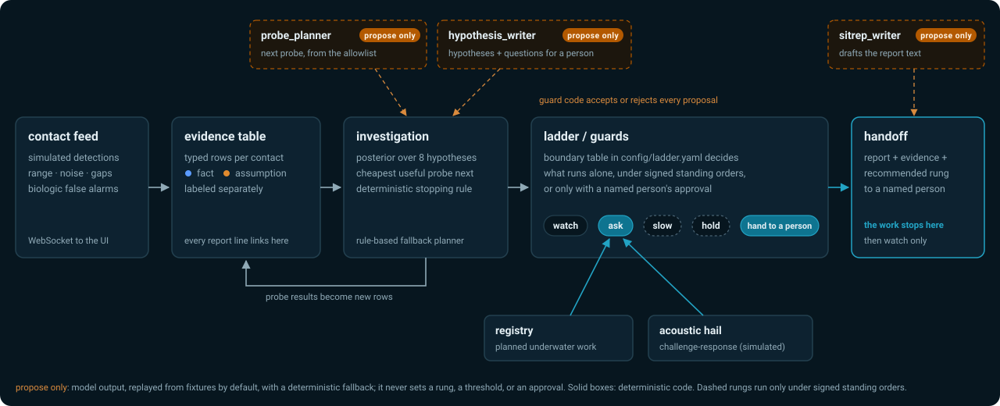
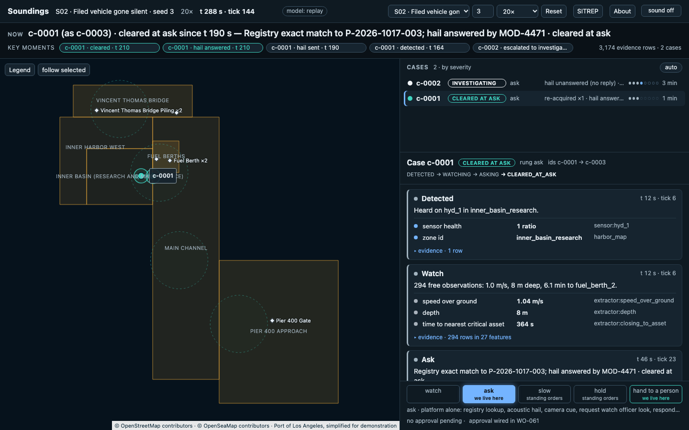
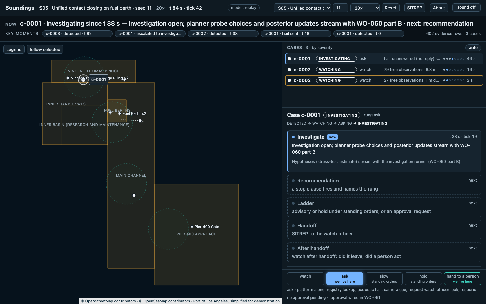
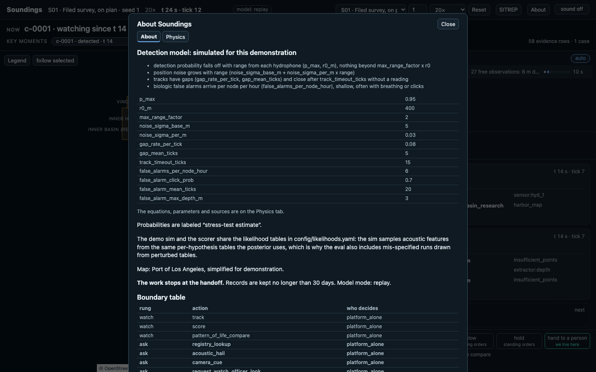

# Soundings

**VTS for the harbor floor.** Resolve every unknown underwater contact at the gentlest rung that works.
InnovateLA Dual-Use Hackathon 2026 · USC Viterbi · Track 01 Marine · lens: Crisis Mitigation (NULL Labs).

Soundings sits with the harbor watch officer between "seen" and "handled" when an unknown autonomous vehicle is in a working harbor. It climbs the organizers' ladder, **watch → ask → slow → hold → hand to a person**, and lives on two rungs: **ask** (a registry of planned underwater work and a simulated acoustic hail clear most contacts with nobody interrupted) and **hand to a person** (a report where every line links to its evidence, plus a recommended rung). In between, an investigation runs the fewest, cheapest probes over a typed evidence table, and deterministic guards decide what the platform does alone, what it does under signed standing orders, and what a named person must approve. Model calls only propose; code decides. The work stops at the handoff. On a quiet Tuesday the same loop finds the research vehicle that went silent.



## The screen

| S02 mid-run: the NOW line, key moments, cases by severity, and one case's steps | S05: a case in INVESTIGATE, the steps still to come shown dim | About: "simulated for this demonstration", the boundary table |
|---|---|---|
|  |  |  |

The screen follows one case; click another to pin it; `focus: sticky` returns. Every concurrent case keeps its row in the cases list and its colour on the map; the focused case owns the NOW line, the key moments, the step view (with a one-line trace of its states and times) and the map's emphasis (WO-060D).

Everything is grouped by case (one contact lineage): each step card says what happened in one sentence, with its evidence rows one click away (fact blue, assumption orange, derived grey). Re-capture with `uv run python scripts/readme_shots.py` (needs `make web`).

## Quickstart

```bash
make setup && make demo   # uv sync + pnpm install, then the demo script replayed offline
```

No API key, no `.env`: every target runs with `MODEL_MODE=replay` (recorded fixtures, deterministic fallbacks). Verified on a fresh clone of `main`: setup needs only the PyPI and npm registries; `make demo` paces in real time (about 4 min; `uv run python -m soundings.demo --script docs/demo-script.yaml --pace fast` for a quick pass). Then `make web && make dev` opens the watch-officer screen on http://localhost:8000; `make check` runs ruff, mypy, pytest, the web build and the denylist.

## Evidence and deck

- **Eval report:** `make eval` runs the scenario catalog × five seeds against two baselines (close the berth on any contact; send everything to a person) and writes [`artifacts/eval/report.md`](artifacts/eval/report.md): rung histogram, missed threats, seconds seen→handled, interruptions/hour. The file is generated, not committed; regenerate it on any clone.
- **Pitch deck:** [`docs/deck/index.html`](docs/deck/index.html); `make deck` rebuilds it from the eval report and exports `docs/deck/deck.pdf` (generated, not committed) · **Boundary table:** [`config/ladder.yaml`](config/ladder.yaml) · **Twist responses:** [`twists/`](twists/)

## Honesty

- **Detection is simulated** for this demonstration: range falloff, noise, track gaps and biologic false alarms are modeled; real sonar signal processing is not.
- **Probabilities are stress-test estimates** from a declared, visible catalog ([`config/`](config/)), never operational forecasts.
- **Physically stopping a vehicle is out of scope** by the sponsor's brief. No state, tool or button for it exists.
- **The work stops at the handoff.** After that, Soundings only watches; the person makes every call, including any call to the Coast Guard or EOD.

## Read in this order

[`CLAUDE.md`](CLAUDE.md) → [`docs/BUILD-PLAN.md`](docs/BUILD-PLAN.md) → [`docs/SPEC-LADDER.md`](docs/SPEC-LADDER.md) → [`docs/SPEC-INVESTIGATION.md`](docs/SPEC-INVESTIGATION.md) → [`docs/SPEC-SIM.md`](docs/SPEC-SIM.md) → [`docs/WORKFLOW.md`](docs/WORKFLOW.md) → [`docs/STATE.md`](docs/STATE.md)

## Repo map

| path | what lives there |
|---|---|
| `soundings/sim/`, `scenarios/` | seeded simulator, detection model, scenario catalog |
| `soundings/investigation/` | evidence table, features, posterior, probes, planner |
| `soundings/ladder/`, `config/` | ladder state machine, guards, standing orders, thresholds |
| `soundings/registry/`, `soundings/challenge/` | registry of planned work, simulated acoustic hail |
| `soundings/llm/` | model roles behind a guard; replay fixtures; fallbacks |
| `soundings/eval/`, `soundings/demo/` | baselines and eval harness; demo script runner |
| `web/` | one-screen React + Leaflet UI (OpenSeaMap tiles) |
